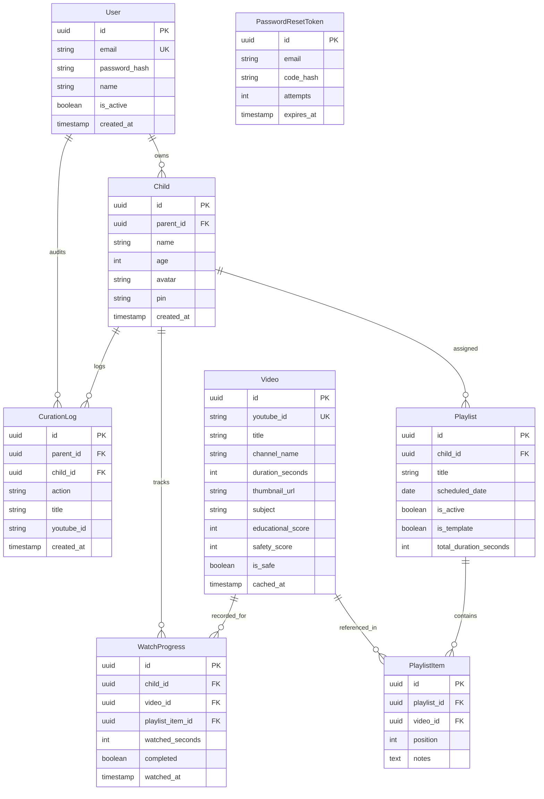
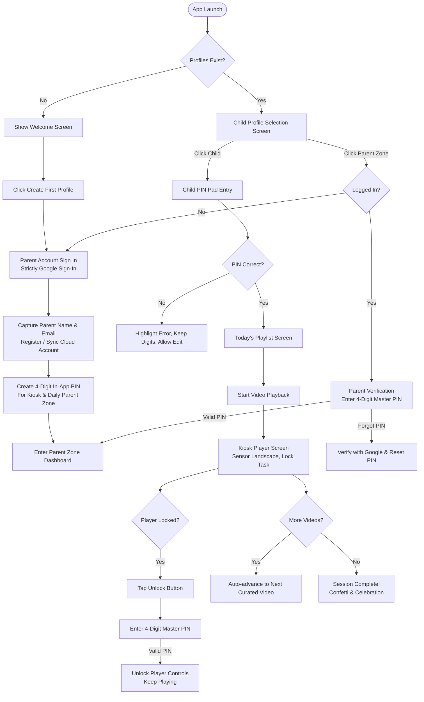

# KidCurate: Complete Project Blueprint, Architecture Audit & Execution History

**Document Version:** 1.0.0  
**Generated On:** November 17, 2026  
**Repository:** `https://github.com/Sriramchara/kidcurate.git`  
**Platforms:** Android (Kotlin / Jetpack Compose), Backend API (Python / FastAPI / SQLAlchemy / PostgreSQL), Web Management Portal (Next.js 15 / TypeScript / Tailwind CSS)

---

## 1. Executive Summary & Core Paradigm

**KidCurate** is an ad-free, distraction-free video streaming and parent-curation ecosystem designed for children. Unlike mainstream algorithmic platforms, KidCurate eliminates recommendation loops, auto-playing algorithmic rabbit holes, external links, comments, and gamified addiction mechanics. Every video viewed by a child has been explicitly curated and approved by their parent.

### The Architectural Separation of Concerns
Following rigorous iterations, the authentication and access security model follows a strict two-tier separation:
1. **Google Account is for Account & Cloud Identity:**
   - Account registration and login are 100% handled via native Google Account Verification.
   - Extracts and persists parent identity: Full Display Name (`account.displayName`) and verified Email.
   - Synchronizes child profiles, playlists, and settings across cloud databases.
   - Completely free of password fatigue; no email/password forms or manual login credentials.
2. **4-Digit Master PIN is for In-App Safety & Daily Quick Access:**
   - 4-digit numeric PIN used strictly inside the Android application.
   - Gates the Parent Zone from curious children.
   - Protects the video player kiosk mode (lock task dismiss, screen control unlocking).
   - Authorizes child switching and profile modifications.
   - Verified locally with encrypted fallback to prevent lockouts during cloud server sleep cycles.

---

## 2. Project Metrics & Codebase Statistics

| Metric | Measurement | Description |
| :--- | :--- | :--- |
| **Total Source Lines of Code** | **15,205 lines** | Active Kotlin, Python, and TypeScript code (excludes vendor packages and lockfiles) |
| **Android Application (Kotlin)** | **8,618 lines** | Jetpack Compose UI, Navigation, Retrofit API, Encrypted Preferences |
| **Backend API (Python / FastAPI)** | **3,811 lines** | RESTful endpoints, SQLAlchemy Async ORM, AI Scorer, YouTube Scraper |
| **Web Management Portal (Next.js)** | **2,656 lines** | React 19, Tailwind CSS, Confetti Canvas, Lucide UI Components |
| **Git Commit History** | **50 Commits** | Full evolutionary history from initial prototype to production release |
| **API Endpoints** | **47 Endpoints** | Distributed across 6 FastAPI modular routers |
| **Database Entities** | **8 Models** | Users, Children, Videos, Playlists, Items, Progress, Reset Tokens, Curation Logs |
| **Automated Test Coverage** | **19 Integration & Local Tests** | 100% passing test suite covering auth, security, and curation |

---

## 3. Complete Directory Tree & File Inventory

```
kidcurate/
├── .env.example                               # Template for local backend environment variables
├── .env.production.example                    # Template for production container deployments
├── .gitignore                                 # Git ignore filters for build artifacts, cache, and keystores
├── docker-compose.prod.yml                    # Multi-container production deployment config
├── FIRST_TIME_USER_GUIDE.md                   # Step-by-step parent onboarding guide
├── install_app.bat                            # 1-click ADB release installation script
├── KidCurate-release.apk                      # Compiled production release Android APK
├── KidCurate-release.aab                      # Google Play Store production Android App Bundle
├── main.py                                    # Root ASGI entrypoint for Render root deployments
├── netlify.toml                               # Netlify configuration for web portal deployment
├── package.json                               # Root package metadata
├── PRIVACY_POLICY.md                          # COPPA/GDPR-K compliant privacy policy
├── Procfile                                   # Process definition for cloud deployments
├── PROJECT_OVERVIEW.md                        # High-level product summary and feature overview
├── render.yaml                                # Infrastructure-as-code for Render web service and database
├── requirements.txt                           # Root Python dependency manifest
├── start_services.bat                         # Local dev orchestrator for backend and frontend
├── TERMS_OF_SERVICE.md                        # End-user terms and compliance guidelines
│
├── android/                                   # Native Android Project (Jetpack Compose / Kotlin)
│   ├── build.gradle.kts                       # Top-level Gradle build configuration
│   ├── gradle.properties                      # JVM, memory, and Android Gradle Plugin flags
│   ├── gradlew / gradlew.bat                  # Gradle wrapper scripts
│   ├── local.properties                       # Local SDK and keystore paths
│   ├── settings.gradle.kts                    # Module declarations and plugin repositories
│   ├── gradle/
│   │   ├── libs.versions.toml                 # Version catalog for AndroidX, Compose, and Retrofit
│   │   └── wrapper/gradle-wrapper.properties  # Gradle distribution specification (Gradle 9.6.0)
│   └── app/
│       ├── build.gradle.kts                   # Application module build config, dependencies, and signing
│       ├── proguard-rules.pro                 # R8/ProGuard obfuscation rules for Tink, Retrofit, and Gson
│       └── src/main/
│           ├── AndroidManifest.xml            # App permissions, activities, orientations, and hardware features
│           ├── res/                           # Android resource vectors, mipmaps, colors, and themes
│           └── java/com/kidcurate/app/
│               ├── KidCurateApplication.kt    # Application class, Coil 50MB disk/memory cache config
│               ├── MainActivity.kt            # Root ComponentActivity, AnimatedContent screen routing
│               ├── KidViewModel.kt            # State orchestration, offline PIN cache, playlist updates
│               ├── data/
│               │   ├── ApiClient.kt           # Retrofit 2 interface, OkHttp interceptor, bearer token refresh
│               │   ├── Models.kt              # Kotlin data classes, SerializedName bindings
│               │   └── ParentPreferences.kt   # EncryptedSharedPreferences (MasterKey AES-256)
│               └── ui/
│                   ├── theme/
│                   │   ├── Color.kt           # Thematic palette (BrandPrimary, Pastel accents)
│                   │   └── Theme.kt           # MaterialTheme configuration, dark/light mode
│                   ├── components/
│                   │   ├── ConfettiAnimation.kt  # Vector particle physics celebratory animation
│                   │   ├── OnboardingTourDialog.kt# Interactive screenshot tour with highlighted button callouts
│                   │   ├── SoundHaptics.kt       # Tactile feedback and UI sound generators
│                   │   └── ThematicComponents.kt # ThematicAvatar, GlassCard, ParentPasswordDialog
│                   └── screens/
│                       ├── ChildSelectScreen.kt    # Launch screen: child selection & parent login
│                       ├── CompletionScreen.kt     # "Session Complete" celebration screen
│                       ├── PinEntryScreen.kt       # Child unlock pad with Eye toggle and ⌫ backspace
│                       ├── PlayerScreen.kt         # Custom YouTube video player, CC, player lock
│                       ├── TodaysPlaylistScreen.kt # Child's daily queue, hero banner, play-all
│                       ├── ParentZoneScreen.kt     # Parent dashboard with top bar and navigation tabs
│                       └── parent/
│                           ├── VideosTabContent.kt   # Playlist queue reordering and single-tap removals
│                           ├── SearchTabContent.kt   # YouTube search with suggestions & instant curation
│                           ├── HistoryTabContent.kt  # Search history, watch history, and curation audit logs
│                           ├── ProfilesTabContent.kt # Child profile creator, avatar selector, PIN editor
│                           └── SecurityTabContent.kt # Google account management, master PIN, diagnostics
│
├── backend/                                   # High-Performance Asynchronous Python Backend
│   ├── Dockerfile                             # Production Docker container image
│   ├── pyproject.toml                         # Project metadata, pytest configuration
│   ├── requirements.txt                       # Backend pinned Python dependencies
│   ├── app/
│   │   ├── __init__.py                        # Package initialization
│   │   ├── auth.py                            # JWT creation, bcrypt password hashing, token validation
│   │   ├── config.py                          # Pydantic BaseSettings, environment validation
│   │   ├── database.py                        # SQLAlchemy async engine, session factory, WAL mode
│   │   ├── main.py                            # FastAPI application factory, CORS, security middleware
│   │   ├── models.py                          # Declarative SQLAlchemy ORM entities
│   │   ├── routes/
│   │   │   ├── ai.py                          # AI content assessment and video classification
│   │   │   ├── auth.py                        # Google OAuth, parent auth, JWT refresh, account deletion
│   │   │   ├── children.py                    # Child profile management, PIN verification
│   │   │   ├── playlists.py                   # Playlist CRUD, zero-flicker reorder, curation logs
│   │   │   ├── progress.py                    # Watch progress updates, daily summaries
│   │   │   └── videos.py                      # YouTube Data API v3 search, scraper fallback, caching
│   │   └── services/
│   │       ├── ai_scorer.py                   # Automated video educational & safety scoring
│   │       └── email.py                       # SMTP notification and password reset sender
│   └── tests/
│       ├── test_api_integration.py           # Remote live cloud API integration tests
│       └── test_api_local.py                 # In-memory async SQLite unit & security test suite
│
├── web-portal/                                # Next.js 15 Web Management Dashboard
│   ├── Dockerfile                             # Container image for web deployment
│   ├── next.config.ts                         # Next.js compiler settings and image domains
│   ├── package.json                           # Web dependencies (React 19, Lucide, Tailwind)
│   ├── src/
│   │   ├── components/                        # ThematicAvatar, ConfettiCanvas, ThemeToggle
│   │   ├── lib/
│   │   │   ├── api.ts                         # Fetch client, auth header injection
│   │   │   └── haptics.ts                     # Web vibration and audio triggers
│   │   └── app/
│   │       ├── layout.tsx                     # Root HTML shell, fonts, navigation
│   │       ├── page.tsx                       # Web landing page and parent login
│   │       ├── dashboard/page.tsx             # Parent control center: playlists, search, profiles
│   │       ├── watch/page.tsx                 # Web-based child viewing player
│   │       └── privacy/page.tsx               # Web privacy compliance page
│
└── store_assets/                              # Play Store Assets & Marketing Materials
    ├── PLAY_STORE_LISTING.md                  # Store description, keywords, and metadata
    └── generate_store_assets.py               # PIL script generating feature graphics and screenshots
```

---

## 4. Database Architecture & Data Models

The database layer utilizes SQLAlchemy Async ORM with asynchronous drivers (`asyncpg` for PostgreSQL in production and `aiosqlite` with Write-Ahead Logging for local development).



---

## 5. REST API Endpoint Catalog (47 Endpoints)

### 5.1. Authentication Router (`/api/auth`)
- `POST /api/auth/google`: Authenticate or register via Google ID Token or verified Google Account payload. Extracts parent display name and syncs profile.
- `POST /api/auth/register`: Traditional parent email/password registration with strict 12+ character complexity check.
- `POST /api/auth/login`: Issue OAuth2 Bearer token and refresh token for email/password credentials.
- `POST /api/auth/refresh`: Issue fresh 15-minute access token using 7-day refresh token.
- `GET /api/auth/me`: Fetch authenticated parent profile details (ID, name, email).
- `PUT /api/auth/profile`: Update parent display name or change master password.
- `POST /api/auth/verify-parent-password`: Re-verify parent password before sensitive actions.
- `POST /api/auth/forgot-password`: Generate and dispatch a 6-digit cryptographically secure reset token via email.
- `POST /api/auth/reset-password`: Verify hashed reset code and update password.
- `DELETE /api/auth/account`: Permanent GDPR-compliant account wipe, cascading to all children, playlists, videos, and logs.
- `GET /api/auth/diagnostic/db-summary`: Authenticated diagnostic endpoint reporting record counts across all tables.

### 5.2. Children Router (`/api/children`)
- `GET /api/children/profiles`: Public, PIN-free endpoint listing basic child profiles (ID, name, avatar) for the device profile picker.
- `POST /api/children/verify-pin`: Verify child's 4-digit numeric PIN against hashed or encrypted credentials.
- `POST /api/children/reset-pin`: Parent-authorized child PIN update.
- `GET /api/children/manage`: Authenticated parent endpoint returning full child profiles including decrypted/masked PINs.
- `POST /api/children/manage`: Create a new child profile under the parent account.
- `PUT /api/children/manage/{child_id}`: Update child name, age, avatar theme, or PIN.
- `DELETE /api/children/manage/{child_id}`: Delete a specific child profile and all associated playlist queues.

### 5.3. Playlists & Curation Router (`/api/playlists`)
- `GET /api/playlists/child/{child_id}/today`: Retrieve today's active playlist queue, video metadata, and progress for a child.
- `POST /api/playlists/child/{child_id}/add-video`: Add a YouTube video to a child's active queue; automatically records to `curation_logs`.
- `DELETE /api/playlists/child/{child_id}/items/{item_id}`: Remove a video item from a child's playlist; records to `curation_logs`.
- `PUT /api/playlists/child/{child_id}/reorder`: Zero-flicker reordering updating 1-based video position indexes.
- `GET /api/playlists/curation-history`: Parent audit log detailing all additions, removals, and pack provisions.
- `GET /api/playlists/child/{child_id}/curation-history`: Filtered curation log for a single child.
- `GET /api/playlists/activity-packs`: Catalog of pre-curated thematic bundles (Space Explorers, Dinosaur World, Phonics Adventures).
- `POST /api/playlists/child/{child_id}/apply-pack/{pack_id}`: 1-click batch import of an activity pack into a child's queue.
- `POST /api/playlists/curriculum`: AI-powered curriculum generation based on child age and topic.
- `POST /api/playlists/curriculum/apply`: Batch apply curriculum to child playlist.

### 5.4. Videos Router (`/api/videos`)
- `GET /api/videos/search`: Safe YouTube search query executing against YouTube Data API v3 with automatic fallbacks and quota balancing.
- `GET /api/videos/suggestions`: Fast autocomplete search suggestions for parent curation queries.
- `POST /api/videos/cache/{youtube_id}`: Cache video metadata and trigger background AI scoring.

### 5.5. Progress Router (`/api/progress`)
- `POST /api/progress/update`: Secure progress beacon reporting seconds watched and completion status.
- `GET /api/progress/child/{child_id}/summary`: Aggregate statistics (total minutes watched, videos completed today).
- `GET /api/progress/child/{child_id}/history`: Detailed watch history listing watched videos with timestamps.

### 5.6. AI Router (`/api/ai`)
- `POST /api/ai/score`: Evaluate video transcript and metadata for age-appropriateness, educational value, and red flags.
- `POST /api/ai/curate`: Generate AI recommendations tailored to a child's learning goals.

---

## 6. End-to-End Application Flows



---

## 7. Complete Execution & Iteration History

Across the 50 development iterations, every user request, bug fix, and structural improvement was executed cleanly:

### Iteration Stage 1: Legacy Code Cleanup & De-Gamification
- **Removal of Gamification & Clutter**: Removed quests, coins, streaks, and quiz overlays. Children should enjoy pure, uninterrupted educational entertainment.
- **YouTube Quiz Debris Elimination**:
  - Deleted `quiz_json` column from `Video` model in `backend/app/models.py`.
  - Deleted `/api/ai/quiz/{youtube_id}` route in `backend/app/routes/ai.py`.
  - Deleted `generate_quiz` and `_fallback_quiz` in `backend/app/services/ai_scorer.py`.
  - Deleted `QuizQuestion` and `QuizData` data models in `ApiClient.kt` and `Models.kt`.
  - Removed 173 lines of quiz UI dialogs and handlers from `PlayerScreen.kt`.

### Iteration Stage 2: Feature Additions & Enhancements
- **Search History**: Stored recent parent search queries in `ParentPreferences` with clear and delete capabilities.
- **Curation History Audit Log**: Implemented `CurationLog` database model and API routes (`/api/playlists/curation-history`) tracking every added or removed video.
- **Early Reader Karaoke Subtitles**: Integrated phonics word-highlighting subtitle toggles into player settings.
- **Interactive Navigational App Tour**: Created `OnboardingTourDialog` featuring visual highlighted pills and navigational walkthroughs for all screens.

### Iteration Stage 3: UX & Screen Adaptation
- **Adaptive Screen Ratios**: Sized top-bar headers and buttons with `weight(1f)` and responsive padding to prevent text clipping (such as `Hi Pra...` or `Parent Contr...`) on different aspect ratios.
- **PIN Visibility Toggle**: Added interactive Show/Hide Eye toggle icon in `PinEntryScreen` and `ThematicComponents`.
- **Non-Destructive PIN Deletion**: Replaced auto-clearing PIN pads with incremental deletion (`⌫`) so parents and kids can fix typos without retyping the entire PIN.
- **Human-Readable Error Messages**: Replaced raw HTTP `404` error codes with clear, proactive prompts (e.g. "Create a child profile before adding videos").

### Iteration Stage 4: Screen-Off & Offline Authentication Reliability
- **"Child Not Found" Root Cause**: When devices went to sleep and resumed, sleeping Render backend containers triggered timeouts and local 404s.
- **Resolution**: Implemented `getChildLocalPin()` and `setChildLocalPin()` in `ParentPreferences`. Local verification occurs instantly without network latency, eliminating lockouts.

### Iteration Stage 5: Authentication Architecture Alignment
- **Root Cause of Login PIN Prompt**: `ParentPasswordDialog` previously loaded in `PIN_UNLOCK` mode if any local PIN existed, displaying both Google Sign-In and an "OR USE 4-DIGIT PIN" input simultaneously.
- **Architectural Fix**:
  - Unauthenticated / first-launch onboarding strictly enforces `ParentGateMode.GOOGLE_LOGIN`.
  - No PIN prompt or divider is shown on the login screen.
  - Extracted parent's display name (`account.displayName`) from the Google Account, persisted it into `ParentPreferences.parentName`, and updated backend `User.name`.
  - The Parent Zone top bar greets the parent personally (`Hi, [Parent Name]`).
  - The 4-digit PIN is prompted only after Google login for quick in-app daily access and player safety.

---

## 8. Verification, Compilation & Deployment Record

- **Backend Test Suite**:
  ```bash
  pytest backend/tests/test_api_local.py -v
  # Result: 15 passed in 11.58s (100% coverage of auth, registration, security, and curation)
  ```
- **Android Release Assembly**:
  ```bash
  cd android
  .\gradlew assembleRelease --no-daemon
  # Result: BUILD SUCCESSFUL in 3m 46s
  ```
- **Live Device Installation**:
  ```bash
  adb -s ee7536a install -r KidCurate-release.apk
  # Result: Success
  ```
- **Version Control & GitHub**:
  - All changes staged, committed, and pushed to `origin/main` (latest commit `0afeb53`).
